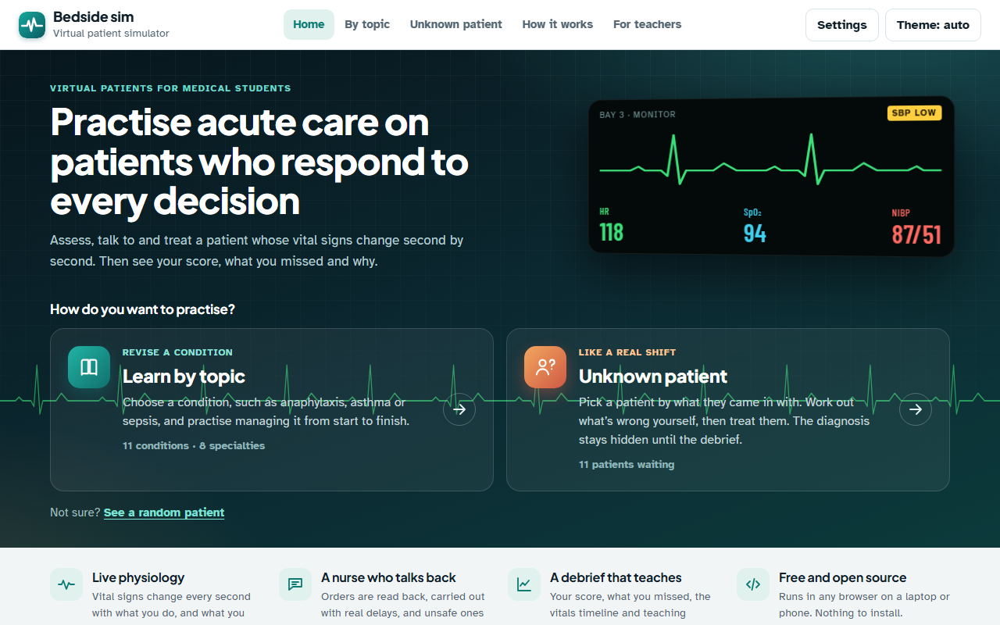
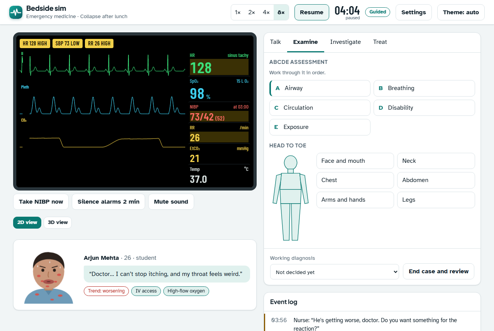
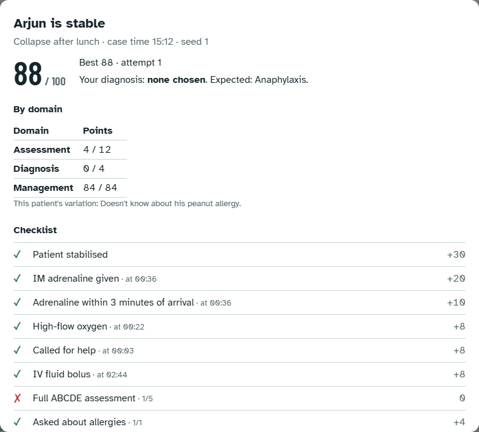
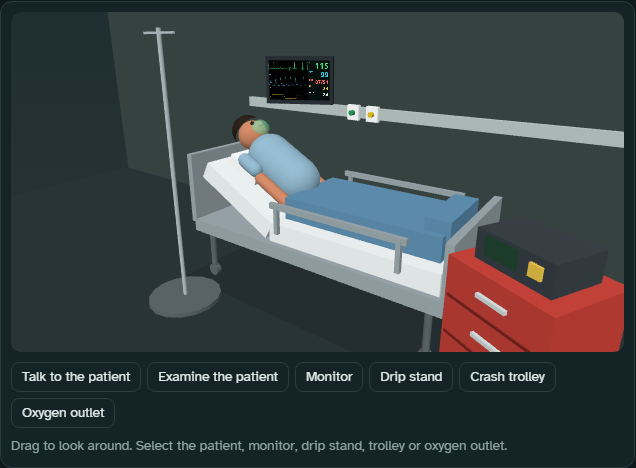
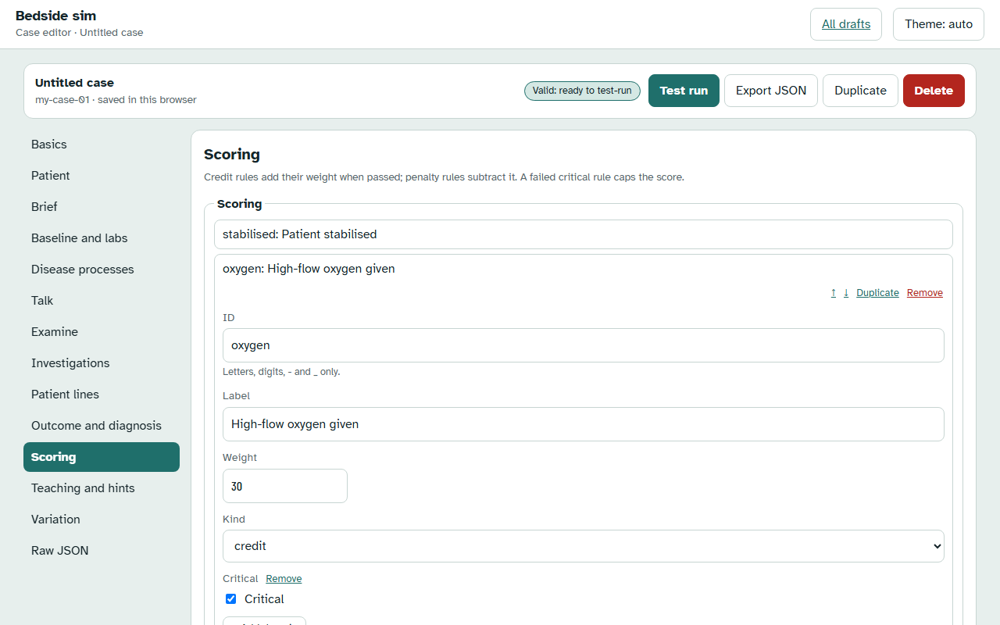
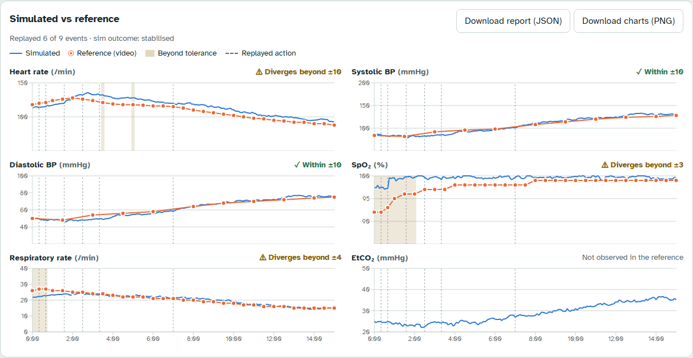
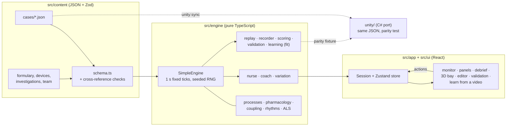

# Bedside sim

> **Educational simulation. Simplified physiology. Not clinical guidance.**

An open-source virtual patient simulator that runs in the browser. You talk to the patient, examine them, order tests and treat them, and their physiology responds in real time to what you do and to what you don't.

**Live demo:** https://yuvism.github.io/bedside-sim/





## Features

- **Two ways to practise:**
  - **Learn by topic:** pick a condition (anaphylaxis, DKA, sepsis…) and practise managing it.
  - **Unknown patient:** pick a patient from a board of people waiting to be seen, by name, age and presenting complaint only. The specialty, diagnosis and topic tags stay hidden, even in the URL, until the debrief. **Surprise me** picks a random patient you haven't seen.
- **A live bedside monitor:**
  - ECG that reflects the rhythm, ST elevation, peaked T waves and CPR artifact
  - SpO₂ pleth, capnography and an arterial line
  - NIBP cycling
  - graded alarms with sound, and a pulse beep whose pitch falls with SpO₂
- **A deterministic, data-driven physiology engine:** disease processes, one-compartment pharmacology with Emax effects, infusions, baroreflex and gas-exchange coupling, a rhythm state machine, and a full ALS loop with CPR, shocks and ROSC. The same seed and the same actions always give the same run.
- **Talk, Examine, Investigate and Treat panels:**
  - examination by ABCDE plus a head-to-toe body map
  - tests with realistic turnaround times and a results inbox
  - a searchable formulary with route, dose and infusion pickers
- **A nurse at the bedside** who reads back your orders, carries them out after realistic delays, and challenges unsafe ones (allergies, contraindications, overdoses, no IV access).
- **Guided and exam modes:** guided mode gives prompts and teaching notes as you go; exam mode is silent, with an OSCE-style breakdown and pass mark at the end.
- **Seeded patient variations:** age, weight, allergies, comorbidities and where the key clue hides, so each run is a little different.
- **Ask the patient anything:** type a question in your own words. With no key, an offline matcher maps it to the case's scripted questions. With your own Anthropic API key (Settings), Claude plays the patient using only what's in the case file, and never reveals the diagnosis or results.
- **Scoring and debrief:** rule-based scoring with critical fails, and a debrief with a checklist, a vitals timeline with action markers and teaching points. Runs can be exported as JSON or CSV, or replayed from any minute.
- **Eleven cases written as plain JSON**, each with an automated ideal-run test and a do-nothing test.
- **Optional 3D bedside view:** a low-poly resus bay that follows the patient's state, with a live monitor screen and clickable objects that open the matching panel. 2D stays the default.
- **Case editor:** build or change a case with forms generated from the case schema, with live validation, a test run at the bedside, and JSON import, export and duplication.
- **Video validation mode (research):** compare a simulated run with a timeline annotated from a real treatment video (RMSE, MAE, maximum deviation, divergence flags and response lags), with JSON and PNG reports. See [docs/validation.md](docs/validation.md).
- **Learn from a video:** annotate a treatment video (or let Claude read the monitor in a frame, with your own key). The case then **updates itself**: a deterministic fit of its bounded values makes the vitals follow the video. It also **proposes what's missing**: scoring, prompts, patient lines, test results and library gaps. Every change goes into an editor draft for review first. The AMAX4 simulation video is included as a worked example. See [docs/validation.md](docs/validation.md#learn-from-a-video).
- **Unity port pack:** a C# port of the engine for Unity 2022 LTS or newer, reading the same JSON, with a parity test that requires it to reproduce the TypeScript engine's run. See [unity/README.md](unity/README.md).

| Debrief                                                                                 | Optional 3D view                                                                      |
| --------------------------------------------------------------------------------------- | ------------------------------------------------------------------------------------- |
|                    |     |
| **Case editor**                                                                         | **Video validation**                                                                  |
|  |  |

## Cases

| Case                           | Specialty      | Guideline                      |
| ------------------------------ | -------------- | ------------------------------ |
| Collapse after lunch           | Emergency      | Resuscitation Council UK 2021  |
| Can't finish a sentence        | Respiratory    | BTS/SIGN 158                   |
| Can't ventilate                | Emergency      | BTS/SIGN 158, AMAX4, DAS 2015  |
| Crushing chest pain            | Cardiology     | ESC ACS 2023, RCUK ALS 2021    |
| Feverish and muddled           | Acute medicine | Surviving Sepsis Campaign 2021 |
| Vomiting and breathing fast    | Endocrinology  | JBDS DKA                       |
| Found drowsy at home           | Endocrinology  | JBDS hypoglycaemia             |
| Unresponsive in the toilets    | Toxicology     | BNF naloxone, RCUK ALS         |
| Motorbike crash, can't breathe | Trauma         | ATLS 10th edition              |
| Pelvic crush                   | Trauma         | ATLS 10th edition, CRASH-2     |
| Weak and dizzy on dialysis day | Renal          | UK Kidney Association 2020     |

## Add a case

1. Open **Case editor** from the case list. Choose **New case** (a playable starter) or duplicate a library case, and edit it section by section. Problems show next to their fields.
2. When it's valid, **Test run** plays it at the bedside. Tune it until it behaves the way you want.
3. **Export JSON** and save the file as `src/content/cases/<case-id>.json`.
4. Add an ideal-run policy for it in `tests/unit/cases/policies.ts`, then run `npm run review:build` and `npm run unity:sync`, and `npm run test`.

Every medical number needs a `source`. Anything not taken directly from a named guideline gets `"reviewNeeded": true` so it appears in [docs/clinical-review.md](docs/clinical-review.md). [CONTRIBUTING.md](CONTRIBUTING.md) explains the case format, the condition language and how to test a case.

## Architecture



The engine has no React, DOM or Zod imports (ESLint enforces it), so it runs headless in tests, in the validation mode and as the reference for the Unity port.

## Run locally

Requires Node 22 or newer.

```bash
npm install
npm run dev
```

| Command                | What it does                                       |
| ---------------------- | -------------------------------------------------- |
| `npm run dev`          | Start the dev server                               |
| `npm run build`        | Type-check and build to `dist/`                    |
| `npm run lint`         | ESLint                                             |
| `npm run test`         | Unit tests (Vitest)                                |
| `npm run test:e2e`     | End-to-end tests (Playwright, on `dist/`)          |
| `npm run format`       | Prettier                                           |
| `npm run review:build` | Rebuild `docs/clinical-review.md` from the content |
| `npm run unity:sync`   | Copy content and parity fixtures into `unity/`     |

For the first e2e run, install the Playwright browser once with `npx playwright install chromium`.

### About the optional AI patient

The AI patient is off by default and the app works fully without it. If you turn it on, your API key is saved only in your browser's local storage and sent only to the Anthropic API, directly from the page. Anyone who can use that browser profile could read it, so use a key with a low spend limit and select **Forget key** when you're done. Each question is billed to your Anthropic account.

## Accessibility

Lighthouse accessibility scores 100 on the case screen, the case list, the editor and the validation page. axe-core finds no WCAG 2.1 AA issues during play (monitor running, nurse query, cardiac arrest, 3D view) in light and dark themes and at 375 px. Every action has a keyboard path (the 3D view has a matching row of buttons), alarms are shown as text as well as colour and sound, and the alarm flash stops when the system asks for reduced motion.

## Credits and inspiration

- [Pulse Physiology Engine](https://pulse.kitware.com/) (Kitware, Apache-2.0) and [BioGears](https://www.biogearsengine.com/) are the reference open-source physiology engines. The engine interface is designed so a Pulse-backed engine can be swapped in for the Unity version.
- [Infirmary Integrated](https://www.infirmary-integrated.com/) is the reference for monitor waveforms and the rhythm list.
- The optional 3D view uses [three.js](https://threejs.org/) (MIT). There are no third-party models, textures or sounds: every 3D object is built from primitives in code. See [ASSETS.md](ASSETS.md).

## Disclaimer

Bedside sim is a teaching tool with a deliberately simplified physiology model. Doses, thresholds and timings are there for teaching, and several are flagged for clinical review (see [docs/clinical-review.md](docs/clinical-review.md)). Don't use it to make decisions about real patients.

## Licence

[MIT](LICENSE)
