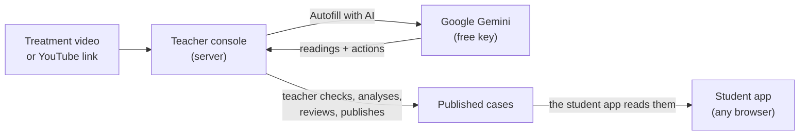
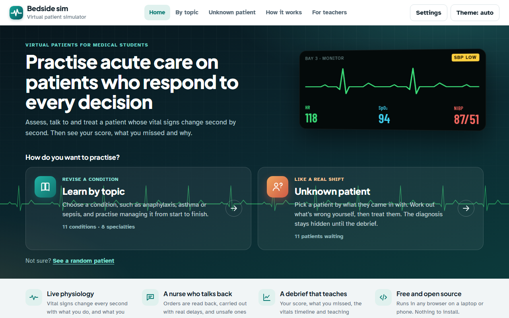
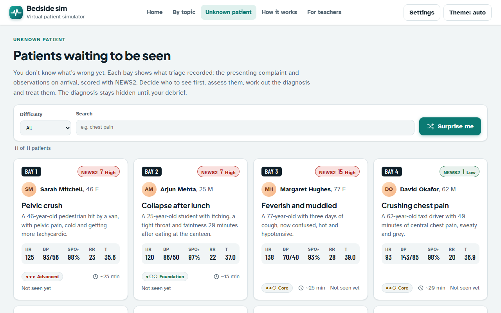
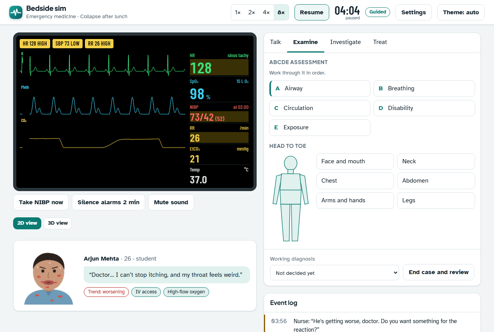
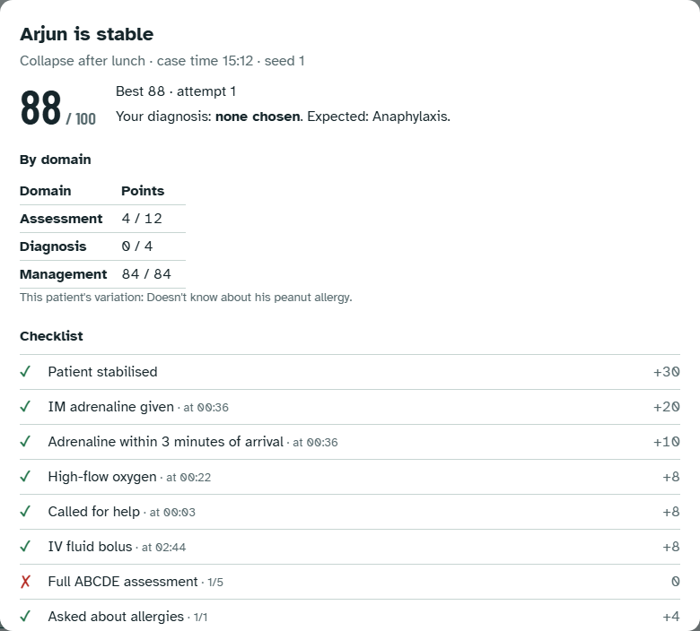
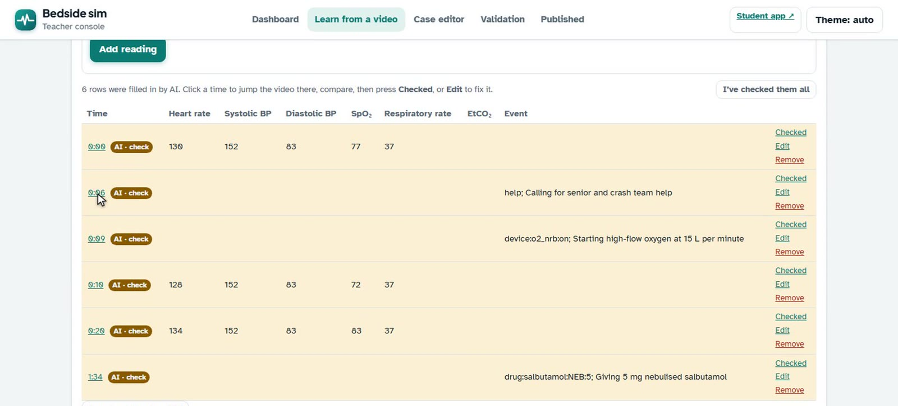

# Bedside sim: project report

_A virtual patient simulator in the browser, with a teacher console that improves the cases from treatment videos. 18 November 2026._

> **Educational simulation. Simplified physiology. Not clinical guidance.**

| Link                         | Address                                                                  |
| ---------------------------- | ------------------------------------------------------------------------ |
| Student app                  | https://yuvism.github.io/bedside-sim/                                    |
| Teacher console              | https://bedside-sim-teacher.onrender.com (teacher password)              |
| Source code                  | https://github.com/yuvism/bedside-sim                                    |
| Project files (Google Drive) | https://drive.google.com/drive/folders/1Pt0a4xQekEdTxbMFzDHo2_6rRkPgPz3n |

## 1. Summary

Bedside sim lets medical students practise acute care on a virtual patient. The student talks to the patient, examines them from A to E, orders tests and gives treatment. The patient's vital signs respond every second to what the student does, and to what they don't do. At the end, a debrief shows the score, the diagnosis and the vital signs over time, with every action marked.

The project is built as **two prototypes**, as the brief asked:

1. **Student app (front end).** Open in any browser, with no sign-in. Students practise by topic or meet an unknown patient and work out the diagnosis themselves.
2. **Teacher console (back end).** A small server with its own web page. A teacher uploads a treatment video or pastes a YouTube link and presses **Autofill with AI**. Google Gemini, on a free key, reads the monitor and lists the team's actions with times. The teacher checks every row. The console then tunes the case so the simulation follows the video and suggests what the case is missing. After review, the teacher publishes the case and it appears in the student app.

| In numbers                                            |                                                                     |
| ----------------------------------------------------- | ------------------------------------------------------------------- |
| Cases                                                 | 11 acute cases in 8 specialties                                     |
| Library                                               | 25 drugs, 3 fluids, 19 investigations, 7 devices and 14 procedures  |
| Automated tests                                       | 269 unit tests and 26 end-to-end browser tests, run on every change |
| Autofill accuracy on a monitor video (AMAX4)          | heart rate within 2.1 /min on average, SpO₂ within 0.3 %            |
| Autofill timing on the 3 most-watched UK ABCDE videos | A–E steps within 0–3 s of the videos' own chapter markers           |
| Accessibility                                         | Lighthouse accessibility score 100; no WCAG 2.1 AA issues found     |

## 2. Aim

Students learn acute care best by doing it, but real emergencies are rare and simulation suites are expensive. The aim was a simulator that:

- runs in a browser, free, on any device;
- has a patient whose physiology responds to treatment in real time, not a fixed branching story;
- follows UK guidelines, with every medical number traced to a source;
- gives useful feedback at the end;
- can be **improved from real treatment videos**, so the cases behave more like real patients over time.

## 3. How the two prototypes fit together

The student app is a static website on GitHub Pages. The teacher console is a Node.js server, online on Render behind a password. It can also run on a laptop with one command. The two are linked: cases a teacher publishes appear in the student app, marked "From your teacher".

## 4. Prototype 1: the student app

**Two ways to practise:**

- **Learn by topic:** pick a condition (anaphylaxis, sepsis, DKA…) and practise managing it.
- **Unknown patient:** a department board shows the patients waiting, with their bay, presenting complaint, observations on arrival and a NEWS2 early warning score. The diagnosis and specialty stay hidden, even in the web address, until the debrief. **Surprise me** picks a patient you haven't seen.

**At the bedside:**

- The patient lies in an illustrated resus bed. Their colour, rash, breathing and consciousness change with their physiology, and oxygen masks, cannulae, drips and monitoring appear as they're used.
- A live monitor shows the ECG, SpO₂, capnography and blood pressure, with graded alarms and a pulse beep whose pitch falls as the saturation drops.
- Four panels: **Talk** (type questions in your own words), **Examine** (A to E plus a head-to-toe body map), **Investigate** (tests with realistic turnaround times) and **Treat** (oxygen, access, fluids, a searchable formulary with doses and infusions).
- **A nurse** reads back each order, carries it out after a realistic delay, and challenges unsafe ones: an allergy, a contraindication, an overdose, or an IV drug with no cannula.
- **Guided mode** gives prompts and teaching notes as you go. **Exam mode** is silent and ends with an OSCE-style breakdown and a pass mark.
- Each run varies a little (age, weight, allergies, where the key clue hides), so a case can be repeated.

**The debrief** shows the outcome, the score, the diagnosis against the expected one, a checklist of what was done, missed or harmful (with times), the vital signs over time with every action marked, and teaching points with references. A run can be replayed from any minute and exported as JSON or CSV.

An optional 3D view of the resus bay follows the same patient state. 2D is the default.

## 5. Prototype 2: the teacher console

The teacher console has five pages: **Dashboard**, **Learn from a video**, **Case editor**, **Validation** and **Published**.

**From a video to students, in six steps:**

1. Open the video in **Learn from a video** (upload a file or paste a public YouTube link) and pick the closest case.
2. Tick that the video is public, or de-identified and approved, and press **Autofill with AI**. Gemini fills in the monitor readings and the team's actions with times.
3. Check every row against the video: click a time to jump the video there, then press **Checked**, **Edit** or **Remove**. Rows from the AI are marked **AI · check**, and analysis stays locked until every one is checked.
4. Press **Analyse the video**. The server tunes the case to follow the video and lists what's missing (section 7).
5. Tick the changes that make clinical sense and create a draft. Review it in the case editor and test-run it at the bedside.
6. Press **Publish to students**. The case appears in the student app.

**Other tools:**

- **Case editor:** forms built from the case format, with live checking, so a teacher can write or change a case without touching code. Drafts can be test-run, exported and published.
- **Video validation:** compare a simulated run with a timeline from a real video, with error measures (RMSE, mean absolute error, largest deviation), divergence flags and response lags, and a downloadable report.
- **Published:** see which cases students get, and unpublish any of them.

**How Autofill with AI works:** the server sends the video to Gemini at one frame a second with a strict answer format. The rules in the prompt say: read the monitor about every 10 seconds; leave a value blank unless it's clearly visible, and never estimate; list the team's actions using the case's own action codes; don't quote dialogue or describe people. The server then checks the answer: values outside a plausible range are dropped, and actions that aren't valid for the case become notes. The video is deleted from the server and from Gemini straight after.

The free Gemini tier allows about 20 requests a day per model. If one model is busy or used up, the console tries the next: Gemini 3.6 Flash, then 3.8 Flash, 4 Hydrogen and 3.5 Flash-Lite. If none can answer, it says which were busy, which were used up, and when the limit resets.

## 6. How the simulation works

The simulation engine is written in plain TypeScript, separate from the web page, so it can run on its own in tests and on the server.

- **Disease processes:** each condition has a severity from 0 to 100 that worsens over time unless treated. The severity drives the vital signs, the lab results and the visible signs.
- **Drugs:** a simple pharmacology model. Each dose is absorbed and cleared over time, and its effect rises and levels off with the amount in the body. IM adrenaline, for example, starts working within a minute and peaks at about three minutes.
- **The body's own responses:** the heart rate rises when blood pressure falls, oxygen levels follow the oxygen given and how well the lungs work, and consciousness falls with low blood pressure, low oxygen or low glucose.
- **Heart rhythms and cardiac arrest:** a full advanced life support loop with CPR, shocks, rhythm checks, adrenaline and amiodarone. Return of circulation depends on the quality of CPR, timing and whether the cause has been fixed.
- **Scoring:** each case has 10–13 rules. Credits add points and penalties take them away. A missed critical action, such as no adrenaline in anaphylaxis, caps the score at 40/100.
- **Repeatable:** the same case, seed and actions always give exactly the same run. This makes replays, tests and the video fitting reliable.

The engine was also ported to C#, so the same cases can run in a Unity app later. A parity test replays the same runs in both languages: all 23 events and 9,783 values match.

## 7. Learning from video

When a teacher presses **Analyse the video**, two things happen.

**The case updates itself.** The fitting changes only a small set of bounded case values (how severe the condition starts, how fast it worsens, how strongly each treatment works, baseline vital signs), each within a set range. It replays the video's actions at their times and searches for the values that make the simulated vital signs closest to the video's. The search has no randomness, so the same video always gives the same proposal.

**It proposes what's missing:** scoring for actions the team took that the case doesn't credit, prompts and patient lines from the notes, test results the case can't answer, and drugs or procedures the library doesn't have yet. Library changes need a sourced edit, so they are only reported, never added automatically.

Nothing changes on its own. Every change goes into a draft that a teacher reviews, and every fitted value is marked for clinical review.

**Worked example: the AMAX4 simulation video.** AMAX4 is a public manikin simulation of a teenager in life-threatening asthma with failing bag-mask ventilation. Analysing it against our asthma case showed that the library had no intubation, no front-of-neck access and no IV salbutamol, and that bag-mask ventilation and IV magnesium weren't scored. This led to the new case **"Can't ventilate"** (asthma-02), where a definitive airway within 4 minutes is a critical action. The fit then brought the simulation much closer to the video:

| Vital (RMSE) | Before the fit | After the fit |
| ------------ | -------------- | ------------- |
| Heart rate   | 41.9           | 11.0          |
| Systolic BP  | 9.6            | 7.6           |
| Diastolic BP | 5.7            | 4.0           |
| SpO₂         | 5.2            | 2.7           |

## 8. The cases

Each case is a plain data file. Every medical number has a source, and anything not taken directly from a named guideline is marked for clinical review.

| Case                           | Condition               | Specialty      | Level      | Guideline                      |
| ------------------------------ | ----------------------- | -------------- | ---------- | ------------------------------ |
| Collapse after lunch           | Anaphylaxis             | Emergency      | Foundation | Resuscitation Council UK 2021  |
| Can't finish a sentence        | Acute severe asthma     | Respiratory    | Core       | BTS/SIGN 158                   |
| Can't ventilate                | Life-threatening asthma | Emergency      | Advanced   | BTS/SIGN 158, AMAX4, DAS 2015  |
| Crushing chest pain            | STEMI                   | Cardiology     | Core       | ESC ACS 2023, RCUK ALS 2021    |
| Feverish and muddled           | Sepsis                  | Acute medicine | Core       | Surviving Sepsis Campaign 2021 |
| Vomiting and breathing fast    | Diabetic ketoacidosis   | Endocrinology  | Core       | JBDS DKA                       |
| Found drowsy at home           | Hypoglycaemia           | Endocrinology  | Foundation | JBDS hypoglycaemia             |
| Unresponsive in the toilets    | Opioid overdose         | Toxicology     | Foundation | BNF naloxone, RCUK ALS         |
| Motorbike crash, can't breathe | Tension pneumothorax    | Trauma         | Advanced   | ATLS 10th edition              |
| Pelvic crush                   | Haemorrhagic shock      | Trauma         | Advanced   | ATLS 10th edition, CRASH-2     |
| Weak and dizzy on dialysis day | Hyperkalaemia           | Renal          | Core       | UK Kidney Association 2020     |

Every case has two automatic tests: an "ideal clinician" run that must stabilise the patient with a mean score of at least 80 across 8 seeds, and a do-nothing run in which the patient must deteriorate and die.

## 9. Testing and results

### Automated tests

- **269 unit tests** cover the engine, every case, scoring, the nurse, the video fitting, the Autofill parsing and the server.
- **26 end-to-end tests** drive both apps in a real browser, including a full teacher flow: upload a video, autofill, check, analyse, draft, publish and unpublish.
- They run on every change on GitHub, together with linting, type checks, the build and the C# parity test.

### Autofill accuracy on a monitor video (AMAX4)

Tested on 16 November 2026 with a free key, against our own hand annotation at the same moments:

| Vital        | Hand readings | AI found | Average error | RMSE |
| ------------ | ------------- | -------- | ------------- | ---- |
| Heart rate   | 28            | 28       | 2.1 /min      | 2.9  |
| Systolic BP  | 12            | 11       | 1.7 mmHg      | 3.1  |
| Diastolic BP | 12            | 11       | 0.5 mmHg      | 1.1  |
| SpO₂         | 11            | 11       | 0.3 %         | 0.5  |

The drugs were placed within 1 second of our times. The AI also listed actions our notes had left out. It missed two: a call for help made before the patient arrived, and IV access, which we had assumed rather than seen.

### The three most-watched UK ABCDE simulation videos

Tested on 17 November 2026 with Gemini 4 Hydrogen. The videos were linked, not copied.

| Video (YouTube views)                         | What Autofill found                                                                                                                                                   |
| --------------------------------------------- | --------------------------------------------------------------------------------------------------------------------------------------------------------------------- |
| Geeky Medics, ABCDE: Sepsis (1.22 M)          | 52 rows in 4 min. The A, B, C, D, E and SBAR steps all within 0–3 s of the video's chapter markers. 12 actions found, from oxygen to antibiotics and the senior call. |
| Resuscitation Council UK, ABCDE demo (0.77 M) | 39 rows in 2 min. Both monitor close-ups read exactly (SpO₂ 96; HR 120, BP 99/59, SpO₂ 97). Visible actions within 0–4 s.                                             |
| Geeky Medics, ABCDE: Asthma (0.25 M)          | 42 rows in 2 min. A, D, E and SBAR within 1–2 s; B and C 9–12 s early. Doses caught as said: salbutamol 5 mg, prednisolone 40 mg.                                     |

**What this shows:** actions and their timing are found reliably. Numbers need a monitor on screen; OSCE-style videos mostly say the observations aloud, so there are fewer readings. The faster backup model made mistakes the full model didn't, which is why the console tries the stronger free models first and why a teacher checks every row. The full test report is in the Drive folder.

**Changes made because of these tests:** hidden retries that wasted free requests were switched off; more fallback models were added; clear messages explain busy models and daily limits; each model gets a 6-minute time limit; and observations said aloud are now used when no monitor is shown.

### Accessibility

Lighthouse scores 100 for accessibility on the main screens. axe-core finds no WCAG 2.1 AA issues during play, in light and dark themes and on a 375 px phone screen. Every action can be done with the keyboard, and alarms are shown as text as well as colour and sound.

## 10. Technology

| Part              | What we used                                                           |
| ----------------- | ---------------------------------------------------------------------- |
| Student app       | React 18, TypeScript, Vite; hosted free on GitHub Pages                |
| Simulation engine | Plain TypeScript with no outside libraries; a C# copy for Unity        |
| Case files        | JSON, checked against a schema (Zod)                                   |
| Teacher console   | Node.js with Express; hosted free on Render, behind a password         |
| AI                | Google Gemini, free tier, through the official `@google/genai` library |
| Charts and 3D     | Recharts for the debrief; three.js for the optional 3D view            |
| Testing           | Vitest (unit), Playwright (browser), GitHub Actions on every change    |

The student app loads fast: the main download is about 157 kB compressed, and the debrief and the 3D view load only when needed.

## 11. Safety, privacy and ethics

- **Not clinical guidance.** The disclaimer is on every screen. The physiology is simplified and some processes are sped up so a case fits a teaching session.
- **Sourced content.** Every dose, threshold and timing has a source. 138 items not taken directly from a guideline are listed for a clinician to review.
- **A person checks the AI.** Every AI row must be checked before analysis, and nothing changes a case until a teacher reviews the draft and publishes it.
- **Videos.** Before autofill, the teacher must confirm the video is public, or de-identified and approved. On Gemini's free tier Google may use what is sent to improve its products, so real patient videos must not be sent on it. Uploads are deleted from the server and from Gemini straight after reading.
- **Keys and access.** The Gemini key stays on the server and never reaches the browser. Online, the teacher console always asks for a password; only the list of published cases is open, so the student app can read it.
- **Copyright.** The test videos were linked, not copied, and our notes are in our own words. The video used in the live demo belongs to the Resuscitation Council UK and is not redistributed.

## 12. Limitations

- The physiology is a teaching model, not a validated clinical model. A clinician still needs to review the flagged items.
- Tuning a case to one video can over-fit to that one patient. Several videos of the same condition would give a better result.
- On the free plans: Gemini allows about 20 requests a day per model, and the online console sleeps after 15 minutes without visitors (it takes 30–60 s to wake) and keeps published cases only until it restarts.
- There is one shared teacher password, not separate teacher accounts.
- The Unity port has been checked in .NET but not yet opened in the Unity Editor.

## 13. Future work

- Clinical review of the flagged items, and more cases.
- Annotate real hospital videos (consented and de-identified), with two people annotating each one and comparing.
- Fit a case to several videos at once.
- Teacher accounts and permanent storage for published cases, on a paid plan or the university's own server.
- Ventilator settings, and porting the scoring and the nurse to the Unity version.

## 14. How to run it

Online, nothing needs installing: open the two links at the top. On a laptop (Node.js 22 or newer):

| Command           | What it does                                       |
| ----------------- | -------------------------------------------------- |
| `npm install`     | Install everything, once                           |
| `npm run dev`     | Start the student app                              |
| `npm run teacher` | Start the teacher console on http://localhost:8787 |
| `npm run demo`    | Start both, connected, for a live demo             |
| `npm test`        | Run the unit tests                                 |

For Autofill with AI, put a free Gemini key from https://aistudio.google.com/apikey in a file called `.env` as `GEMINI_API_KEY=…`. The README explains each step, including how to put the console online on Render.

## 15. What's in the Google Drive folder

- **This report.**
- **1 Presentation:** the 7-slide presentation (PowerPoint and PDF), with the how-to video built in.
- **2 Videos:** a narrated 2-minute video on how to use the simulator, with subtitles, and a short sample clip recorded from our own simulator.
- **3 Test report:** the full ABCDE video test report and the AI timelines.
- **4 Code:** the complete source code, as a folder and as a zip.

## 16. References and credits

- **Guidelines used in the cases:** Resuscitation Council UK 2021 (emergency treatment of anaphylaxis; adult advanced life support); BTS/SIGN 158 British guideline on the management of asthma; Difficult Airway Society 2015; ESC 2023 guidelines for acute coronary syndromes; Surviving Sepsis Campaign 2021; JBDS guidelines for DKA and for hypoglycaemia; BNF (naloxone and other doses); ATLS 10th edition; CRASH-2; UK Kidney Association 2020 (hyperkalaemia); Royal College of Physicians NEWS2 (2017).
- **Videos tested** (linked, not copied):
  - Geeky Medics, "ABCDE Assessment: Sepsis": https://www.youtube.com/watch?v=Ix7kP8-rIpA
  - Resuscitation Council UK, "RC (UK) ABCDE assessment demo": https://www.youtube.com/watch?v=KNqoXboSVUI
  - Geeky Medics, "ABCDE Assessment: Asthma": https://www.youtube.com/watch?v=AKRr2PMl4zE
  - Live to the MAX!, "AMAX4 Simulation MASTER": https://www.youtube.com/watch?v=o3NDS3snnxc
- **Open-source inspiration:** the Pulse Physiology Engine (Kitware) and BioGears for physiology; Infirmary Integrated for monitor waveforms; three.js for the 3D view. No third-party models, images or sounds are used.
- **Licence:** MIT, free to use and adapt.

_Educational simulation. Simplified physiology. Not clinical guidance._
