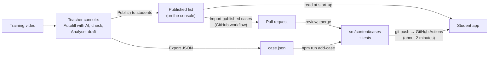

# From a training video to the student app

_Educational simulation. Simplified physiology. Not clinical guidance._

A case updated from a video reaches students in one of two ways: **published** from the teacher console (instant, but only while that console keeps it), or **added to the code** (permanent, in every copy of the app). The second can be fully automated.



## 1. Make the case in the teacher console

1. Open **Learn from a video**, upload the video (or paste a public YouTube link) and pick the closest case.
2. Tick that the video is public, or de-identified and approved, and press **Autofill with AI**.
3. Check every row (rows from the AI are marked **AI · check**), then press **Analyse the video**.
4. Tick the changes that make clinical sense and press **Create a draft for review**. The draft is a new case, `<case>-video`.
5. In the case editor, **Test run** it at the bedside.

## 2a. Publish it (instant)

Press **Publish to students**. Student apps connected to the console show it at their next start, marked "From your teacher".

On Render's free plan the console keeps published cases only until it restarts or redeploys. To keep a case, also do 2b.

## 2b. Add it to the code (permanent)

1. In the case editor, press **Export JSON**. The browser saves `<case>-video.json`.
2. In the project folder, run:

   ```bash
   npm run add-case -- "C:\Users\you\Downloads\asthma-02-video.json" --push
   ```

   This:
   - checks the case against the schema and the shared library;
   - saves it as `src/content/cases/<id>.json`;
   - refreshes `docs/clinical-review.md` and the Unity copies;
   - runs all the unit tests, so the new case must stabilise with the ideal treatment and get worse without it;
   - commits and pushes. GitHub Actions then rebuilds the student app, and the case is live in about 2 minutes.

   Without `--push` it stops after the tests and prints the three git commands. `--replace` updates a case that is already there, and `--no-test` skips the tests.

A case made from another one (an `-video` draft, or a copy made with **Duplicate**) is tested with the ideal run of the case it came from. A brand-new case needs its own ideal run in `tests/unit/cases/policies.ts`; see [CONTRIBUTING.md](../CONTRIBUTING.md).

If a test fails, nothing is pushed. Fix the case in the editor, export it again and run `add-case` with `--replace`, or delete the file.

## 3. Automate it

**Everything the console published, in one command:**

```bash
npm run import-published -- https://bedside-sim-teacher.onrender.com
```

It reads the console's list of published cases (open to anyone, so no password is needed), adds every case that isn't in the library yet and refreshes the generated files. Then run `npm test`, commit and push.

**Fully automatic, on GitHub:** the workflow [Import published cases](../.github/workflows/import-published.yml) runs `import-published`, then lint, the type checks and all the tests. If anything new was published, it opens a pull request. Merging the pull request deploys it.

Set up once:

1. In the repository's **Settings → Secrets and variables → Actions → Variables**, set `TEACHER_API_URL` to the console's address. (This project already has it.)
2. In **Settings → Actions → General → Workflow permissions**, tick **Allow GitHub Actions to create and approve pull requests**. Without it, the workflow pushes a branch and prints a link to open the pull request yourself.

Run it from **Actions → Import published cases → Run workflow**. To run it every night, remove the `#` in front of the `schedule` lines in the workflow file.

Keep the pull request step. It is where a clinician reviews a case before every student gets it: the fitted values are marked `reviewNeeded`, so they show up in `docs/clinical-review.md`.
